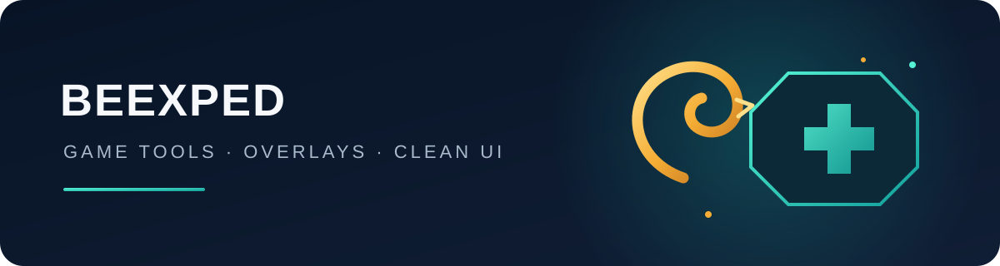

  
  <h1>beexped</h1>
  
<strong>Building a smarter Hearthstone Battlegrounds overlay.</strong>

  
Game tools · useful data · clean interfaces

---

### 🎮 What I’m working on

A desktop companion for Battlegrounds: quick-to-read information, a tidy interface, and less tab-hopping while playing.

### 🐍 Contribution trail

<picture>
  <source media="(prefers-color-scheme: dark)" srcset="https://raw.githubusercontent.com/beexped7valorant-cmd/beexped7valorant-cmd/output/github-snake-dark.svg" />
  <source media="(prefers-color-scheme: light)" srcset="https://raw.githubusercontent.com/beexped7valorant-cmd/beexped7valorant-cmd/output/github-snake.svg" />
  
</picture>

Snake artwork refreshes daily through GitHub Actions.
